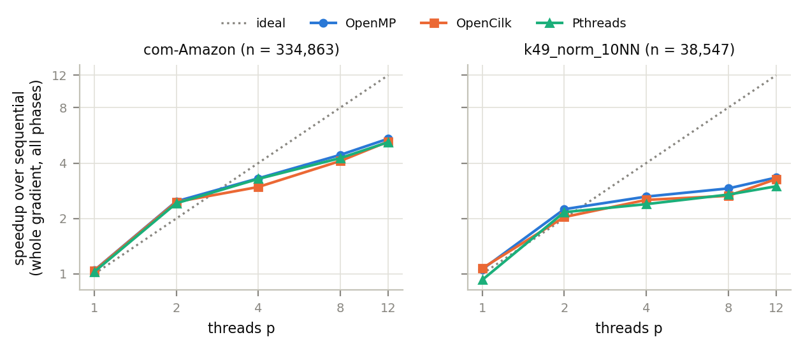

# 1. What is computed

For a graph with affinity matrix $W$, t-SNE places node $i$ at $y_i \in \mathbb{R}^2$ to
minimize $\mathrm{KL}(P\Vert Q)$. Its gradient,
$\partial C/\partial y_i = 4(F^{\mathrm{attr}}_i - F^{\mathrm{rep}}_i)$, splits into an
attraction along the edges, $F^{\mathrm{attr}} = (D-A)Y^{\mathsf T}$ with
$A_{ij} = p_{ij}(1+d_{ij}^2)^{-1}$ on the pattern of $W$ (a sparse × dense product,
$O(\mathrm{nnz})$), and a repulsion among all pairs normalized by $Z$, which costs $O(n^2)$
directly and about $O(n\log n)$ with a quadtree and Barnes–Hut. I compute it at the
given $Y_0$ with $u = 10$, $\theta = 0.5$, in four versions (sequential, OpenMP, OpenCilk,
Pthreads) that share all the math (`src/tsne.c`) and differ only in how loops are split.

# 2. Data structures and sequential algorithms

$W$ stays in the CSC form of the course reader; since it is symmetric, column $i$ is row
$i$. $P$ is a second value array on the same pattern, so $p_{ij}$ sits at the index of
$w_{ij}$. $Y$ and the forces are arrays of $2n$ doubles.

**$P$.** Per row, `cond_row` returns a uniform row ($\beta_i = 0$) if $u \ge d_i$ or all
weights are equal; otherwise it doubles an upper bound on $\beta_i$ until
$H_i(\beta) \le \log u$, then bisects to $|H_i - \log u| < 10^{-5}$, using
$(w_{ij}/\max_k w_{ik})^{\beta}$. Bisection works because $H_i$ falls monotonically from
$\log d_i$ at $\beta = 0$. On k49, 34,098 of 38,547 rows need it, at 18.3 entropy
evaluations per row on average. To symmetrize, `build_mirror` finds for each entry
$(i,j)$ the index of $(j,i)$: visiting the columns $j$ in increasing order, the entries
pointing into column $i$ arrive in the order of column $i$'s own (sorted) rows, so with
one counter per column the partner is `next[i]++` — the CSC transpose, $O(\mathrm{nnz})$.
It replaced a binary search per entry: identical table, 5–7× faster (com-Amazon 71 → 12
ms), but sequential, since `next[]` carries state from column to column.

**Attraction.** `attr_row` computes row $i$ of $(D-A)Y^{\mathsf T}$ without forming $A$
or $D$: for each neighbor it computes $A_{ij}$ on the fly and accumulates
$A_{ij}(y_i - y_j)$. Each row writes only its own output.

**Quadtree (fixed depth $L$).** The bounding square of $Y$ is cut into $2^L \times 2^L$
leaves; level $l$ is three plain arrays of $4^l$ cells (`cnt`, `sumx`, `sumy`). Cell
$(c_x, c_y)$ is at index $c_y 2^l + c_x$ and its children are $(2c_x + a, 2c_y + b)$:
no pointers. *Build*: a counting sort — each point's leaf, counts, prefix sum into
`start`, scatter of point indices into `perm`, so leaf $c$ holds
`perm[start[c]..start[c+1]-1]`; $O(n + 4^L)$. *Centers of mass*: a leaf sums its points;
any other cell adds its four children's counts and coordinate sums; levels $L \to 0$.
*Walk*: for point $i$, from the root, skip empty cells; if
$r_{\mathrm{cell}} < \theta\,\Vert y_i - y_{\mathrm{cell}}\Vert$ with $r$ the cell
**diagonal**, add $N q^2 (y_i - y_{\mathrm{cell}})$ and $N q$, $q = (1 + d^2)^{-1}$;
else a leaf adds its points one by one, skipping $j = i$, and an inner cell visits its
children. A cell containing $y_i$ is never accepted ($y_i$ is within one diagonal of its
center; acceptance needs two). Each walk returns its share $z_i$; then
$Z = \sum_i z_i$ and $F^{\mathrm{rep}} /\!= Z$.

**Choice of $L$.** Figure 1: shallow trees spend the walk in long leaf sums (com-Amazon
29 s at $L = 5$), deep trees in visiting many small, mostly empty cells. The best depths
leave about 9 (k49) and 5 (com-Amazon) points per leaf, so the default is
$L = \mathrm{round}(\log_4(n/8))$, about 8 points per leaf; it picks the measured best on
both graphs and depends only on $n$. Accuracy does not depend on $L$. With it, each point
computes about 570 terms instead of $n - 1$ (k49: 566 = 219 cells + 347 points; com-Amazon:
584), every other point covered exactly once (`src/count_terms.c`).

{width=48%}

# 3. Parallelization

Every phase is a loop over independent rows, points, cells or entries; the three models
split the same loops (`src/omp.c`, `src/cilk.c`, `src/pth.c`).

| loop | OpenMP | OpenCilk | Pthreads | why |
|---|---|---|---|---|
| rows of $P$, attraction, walk, direct sum | `dynamic, 256` | `cilk_for` | chunks of 256 from an atomic counter | costs differ per row (degree, bisection steps) and per point (dense regions: up to 1,579 terms vs 584 on average) |
| symmetrize, normalize, gradient, copies | `static` | `cilk_for` | chunks of 4,096 | equal, tiny iterations |
| leaf of each point + count | `atomic` | `__atomic_fetch_add` | `__atomic_fetch_add` | two points may hit the same leaf counter |
| scatter into `perm` | `atomic capture` | `__atomic_fetch_add` | `__atomic_fetch_add` | each point takes the next free slot of its leaf |
| centers of mass | per level, levels in order | same | same | a level needs its children |
| mirror, prefix sum, bounding box, $\sum z_i$ | sequential | sequential | sequential | loop-carried (`next[]`), $4^L$ cells, < 1 ms |

$Z$ is summed from an array of $z_i$ in one sequential loop, the same order in every
version, so no thread shares an accumulator. In Pthreads, `parallel_for(n, chunk, body)`
creates $p$ threads that take chunks `[lo, lo+chunk)` from a shared atomic counter until
it passes $n$, then joins them. `cilk_for` splits ranges recursively and balances by work
stealing. OpenMP runs with `OMP_WAIT_POLICY=passive` (Section 6).

**Agreement.** All four versions agree to round-off on all three graphs
($\le 2.6\cdot10^{-15}$ relative in every output; `src/agree.c`, `results/agreement.txt`):
the atomic scatter changes the order of points inside a leaf, and gcc and
clang combine floating-point operations differently.

# 4. Results

**Machine.** Intel Core i5-1235U: 2 performance cores (hyper-threaded, up to 4.4 GHz) +
8 efficiency cores (up to 3.3 GHz), 12 hardware threads; L2 1.25 MB per performance core,
L3 12 MB; 7.6 GB RAM visible to WSL2 (Ubuntu 24.04; `lscpu` misreports the CPU as 6 × 2).
gcc 13.3 (`-O3 -march=native`, `-fopenmp` / `-pthread`), OpenCilk 3.0 clang 19.1.7
(`-O3 -march=native -fopencilk`). Every time is the median of 5 runs
(`scripts/bench.sh`, `results/timings.txt`).

**Accuracy** against `<graph>-ref.mat` ($F$: $\max|x - x_{\mathrm{ref}}|/\max|x_{\mathrm{ref}}|$):

| graph | $\max\lvert\beta - \beta_{\mathrm{ref}}\rvert$ | $F^{\mathrm{attr}}$ | $F^{\mathrm{rep}}$ | $Z$ |
|---|---|---|---|---|
| k49_norm_10NN | 1.2e-4 | 1.2e-5 | 8.9e-3 | 5.1e-3 |
| com-Amazon | 0 | 7.9e-16 | 8.1e-3 | 4.9e-3 |
| coPapersDBLP | 0 | 3.9e-15 | 5.6e-3 | 3.6e-3 |

$\beta$ and $F^{\mathrm{attr}}$ agree to the bisection tolerance (weighted) or to round-off
(unweighted); Barnes–Hut stays below $10^{-2}$.

**Time per phase** (ms; sequential, and 12 threads with speedup):

| graph | version | $P$ (mirror) | attraction | build | mass | walk | total |
|---|---|---|---|---|---|---|---|
| k49 | seq | 242 (3.0) | 1.5 | 0.5 | 0.07 | 142 | 386 |
| | OpenMP 12 | 70 (2.8) | 1.0 | 2.0 | 3.8 | 39 | 116 (**3.3×**) |
| | OpenCilk 12 | 74 (2.7) | 0.5 | 1.3 | 0.09 | 42 | 118 (**3.3×**) |
| | Pthreads 12 | 76 (2.7) | 2.0 | 2.6 | 3.7 | 44 | 129 (**3.0×**) |
| com-Amazon | seq | 55 (15.4) | 10.4 | 7.6 | 2.0 | 2,597 | 2,677 |
| | OpenMP 12 | 30 (11.9) | 5.4 | 12.4 | 6.6 | 437 | 494 (**5.4×**) |
| | OpenCilk 12 | 32 (14.4) | 5.1 | 9.2 | 0.9 | 464 | 511 (**5.2×**) |
| | Pthreads 12 | 32 (11.9) | 7.3 | 14.1 | 7.7 | 453 | 515 (**5.2×**) |
| coPapersDBLP | seq | 574 (151) | 80.6 | 10.3 | 2.6 | 3,275 | 3,952 |
| | OpenMP 12 | 261 (114) | 26.1 | 9.5 | 6.6 | 662 | 968 (**4.1×**) |
| | OpenCilk 12 | 242 (115) | 25.0 | 9.6 | 2.0 | 657 | 938 (**4.2×**) |
| | Pthreads 12 | 278 (105) | 23.6 | 9.4 | 6.3 | 637 | 957 (**4.1×**) |

{width=80%}

**What limits each phase.**
*Walk* (97% of the sequential time on com-Amazon, 83% on coPapersDBLP) scales best: 5.9×
on com-Amazon, 4.9–5.1× on coPapersDBLP, 3.7× on k49. Points are
independent and read-only on the tree, so the limits are the hardware and the balance:
only 2 of the 10 cores are performance cores, threads 3–12 run on efficiency cores at
about 3/4 of the clock and share caches, and per point costs differ (584 terms on average,
up to 1,579). The jump from 1 to 2 threads is superlinear on com-Amazon (2.5×), which I
attribute to the single thread not always running on a performance core (not verified).
*$P$* reaches 3.2–3.5× on k49, where bisection dominates, but only 1.7–1.8× on com-Amazon
and 2.1–2.4× on coPapersDBLP, where rows are uniform and the sequential mirror stays: 12 of
the 30 ms that remain on com-Amazon, 105–115 of 242–278 ms (44%) on coPapersDBLP (Amdahl).
*Attraction* reaches 0.7–2.8× on k49 and com-Amazon but 3.1–3.4× on coPapersDBLP: a few
flops per nonzero against an indirect read of $y_j$ and the streaming of `row`, `P`, so it is
memory-bound; on k49 (1.5 ms) it is too short to amortize starting the threads, while the
long rows of coPapersDBLP (median degree 34) give each thread enough work. *Build and centers of mass* mostly get slower (build 0.2–0.8×; centers of mass 0.03–0.3× with OpenMP and Pthreads): they take
1–10 ms, the bounding box and prefix sum are sequential, and the counting sort pays one
atomic per point. Starting threads costs as much as the work: Pthreads creates and joins
$p$ threads in every `parallel_for` (9 calls for the 9 levels of the centers of mass) and
passive OpenMP wakes its threads for every loop, both 6–8 ms at 12 threads on com-Amazon,
while `cilk_for` runs a short loop on the worker that starts it unless others steal
(0.9 ms, a 2.4× speedup).
*Across graphs* (`figs/scaling_n.png`): the walk grows about linearly in $n$ (terms per
point 566, 584, 698), but its time per term is 6.5 ns on k49, 13.3 ns on com-Amazon and
8.7 ns on coPapersDBLP, so cache size alone does not explain it (Section 5). The phases
proportional to nnz grow with nnz, not $n$: from com-Amazon to coPapersDBLP, nnz grows
16.5×, $P$ 10×, attraction 7.7×, while $n$ grows 1.6×. $P$ is faster on com-Amazon than on
k49 despite 3× the nonzeros: no bisection.

**Barnes–Hut against the direct sum** (k49, parallel `rep_direct_point`): the direct
$O(n^2)$ repulsion takes 2,271 ms sequentially and 406–410 ms at 12 threads (5.5×, it
scales better than the walk: regular, compute-bound). Barnes–Hut (build + mass + walk) is
**15.9× faster** sequentially and **8–9× faster** at 12 threads, while its error is
$8.9\cdot10^{-3}$ instead of $1.2\cdot10^{-4}$ (the reference itself is Barnes–Hut at
$\theta = 0.1$). **Below what $n$ is the direct sum faster?** Timing both on the first
$m$ points of k49 (`src/crossover.c`, median of 7; `results/crossover_p1.txt`,
`crossover_p12.txt`): sequentially they tie at **$n \approx 1{,}000$** (1.3 ms each);
below it the direct sum wins (0.58× at $m = 100$), above it Barnes–Hut wins by a factor that
grows with $n$ (1.6× at 2,000, 4.9× at 10,000, 14.9× at 38,547). With 12 threads
the crossover moves to **$n \approx 5{,}000$** (13 ms each): Barnes–Hut has a floor of about
6 ms even for 100 points, from starting its 8 to 11 parallel loops (tree build, one per
level for the centers of mass, walk, normalization), while the direct sum has two loops
and costs 1.3–1.8 ms up to $m = 500$. Barnes–Hut stays within $10^{-2}$ of the direct sum at every $m$.

# 5. Predict, then measure: coPapersDBLP

Before running it (prediction committed first: `results/prediction_coPapersDBLP.md`,
`scripts/predict.py`), I predicted each phase from com-Amazon, also unweighted and also
larger than the cache: sequential time = com-Amazon's time per unit × coPapersDBLP's
units — per nonzero for $P$, mirror and attraction (16.5× more), per point for build and
mass (1.6×), per term for the walk ($n$ × 584 terms); in parallel, each phase keeps its
com-Amazon speedup, the mirror staying sequential. Expected: the walk still dominates,
but $P$ grows from 2% to 17% of the sequential time, and at 12 threads the mirror is 40%
of $P$.

| phase (ms) | predicted seq | measured seq | error | predicted OpenMP 12 | measured OpenMP 12 | error |
|---|---|---|---|---|---|---|
| $P$ (mirror) | 913 (253) | 574 (151) | −37% | 499 (195) | 261 (114) | −48% |
| attraction | 171 | 81 | −53% | 88 | 26 | −71% |
| build / mass | 12 / 3.3 | 10 / 2.6 | −16% / −21% | 20 / 11 | 9.5 / 6.6 | −52% / −38% |
| walk | 4,192 | 3,275 | −22% | 706 | 662 | −6% |
| total | 5,298 | 3,952 | −25% | 1,327 | 968 | −27% |

(All versions: `results/prediction_vs_measured_coPapersDBLP.md`.) The structure was right:
the walk still dominates (83%), $P$ rises from 2% to 15% of the sequential time (predicted
17%), and at 12 threads the mirror is 44% of $P$ (predicted 40%), which caps $P$ at 2.2×.
Every phase except the tiny gradient (+3 ms) was overestimated, for two different reasons.
*$P$ and attraction cost less per nonzero* than on com-Amazon: 18.8 vs 29.9 ns and
2.6 vs 5.6 ns. This was the first risk noted before the run: with median degree 34
instead of 4, the per-row work (loop setup, the min/max pass, loading $y_i$) is shared by
8× more entries; the model scaled per nonzero what is partly per row.
*The walk does more work but takes less time*: 698 terms per point instead of the assumed
584 (+20%; the assumption was wrong), but 8.7 ns per term instead of 13.3 (−35%). Near-leaf
terms, which need no division or square root, are 46% of the terms instead of 36%, and
consecutive node numbers may be close in the plane, reusing the cells in cache; I did not
verify which dominates.
*In parallel*, the walk lands at −6% only by compensation: a faster sequential walk with a
smaller speedup (4.9× vs 5.9× on com-Amazon). So the speedup of the whole gradient is
4.1–4.2×, below com-Amazon's 5.2–5.4×, as the larger sequential mirror predicted.

# 6. One bug: OpenMP got slower with more threads

*Noticed.* In the first benchmark, OpenMP's $P$ phase on com-Amazon took 40 ms on 1
thread but **95 ms on 12**, while OpenCilk and Pthreads stayed near 30 ms
(`results/timings_omp_active.txt`). Slower with more threads, in one version only.
*Found.* $P$ has three parts; the per-part times showed the parallel loops were fine and
the extra time was in `build_mirror` — the one part that runs on a **single thread** in
every version: 31 ms with 12 OpenMP threads against 12–14 ms in OpenCilk and Pthreads. Nothing in the mirror
depends on OpenMP, so the slowdown had to come from the other threads. gcc's OpenMP keeps
idle threads **spinning** for a while after a parallel loop so that the next loop starts
fast; the 11 spinning threads compete with the one thread doing the mirror, including its
hyper-threaded sibling. Test: 12 threads, 3 runs each — mirror 19–66 ms with spinning
threads, 11–13 ms with `OMP_WAIT_POLICY=passive` (`results/omp_wait_policy.txt`).
*Fixed.* The benchmark sets `OMP_WAIT_POLICY=passive`: $P$ drops from 95 to 30 ms
(com-Amazon) and from 105 to 70 ms (k49). *But* it is a trade-off, not a free fix: woken
threads start each loop later, so the tiny loops pay — the centers of mass go from 0.9 to
6.6 ms and the attraction from 3.1 to 5.4 ms on com-Amazon; the walk is unchanged
(454 vs 437 ms). Spinning favors many short parallel loops; sleeping favors sequential
code between them.

# 7. Use of AI assistants

I developed this project with Claude (Anthropic), used through Claude Code as a pair
programmer. Claude helped me understand t-SNE, its gradient and the Barnes–Hut method, and
how OpenMP, OpenCilk and Pthreads work, through explanations and worked examples as we
wrote each part. I specified each part and the rules it had to follow (a fixed-depth
quadtree with plain arrays; all the math in one file shared by the four versions; the
simplest code unless a measurement shows otherwise; no run of `coPapersDBLP` before my
prediction), chose between the alternatives it proposed (the counter instead of a binary
search for the mirror table, the OpenMP wait policy, which bug to report), tested and
questioned each step, and had every part explained until I could explain it myself.
Claude assisted me in writing the code and the scripts to these specifications (Claude Code wrote the plotting script
entirely) and ran the measurements. What it got
wrong that I caught: it told me to run `coPapersDBLP` before I had made the prediction;
it described the direct $O(n^2)$ sum as part of the sequential version, while the
assignment asks for it in parallel; and it found the mirror table with a binary search per
entry until I asked for something simpler. Its first OpenCilk code also contained a
`cilk_for` that silently ran sequentially, found from the compiler's warning. Every number
in this report comes from a file in `results/`, generated by the code in `src/` and
`scripts/`.

# References

[1] L. van der Maaten. Accelerating t-SNE using tree-based algorithms. *JMLR* 15:3221–3245, 2014.
[2] J. Barnes, P. Hut. A hierarchical $O(N \log N)$ force-calculation algorithm. *Nature* 324:446–449, 1986.
[3] M. Wattenberg, F. Viégas, I. Johnson. How to use t-SNE effectively. *Distill*, 2016.
